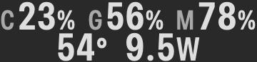

# Stats Dense

**A compact menu bar dashboard for small-screen Macs.**

Keep the numbers you check most often visible without letting your system monitor take over the menu bar. Stats Dense is an independent fork of [Stats](https://github.com/exelban/stats), with a two-row dashboard designed for MacBooks where menu bar space is scarce.

> **Current scope: five fixed metrics.** Dense always displays **CPU usage, GPU usage, RAM usage, temperature, and system power**. These slots cannot currently be replaced with network speed, disk activity, fan speed, or other metrics. This is a focused five-metric layout, not a general-purpose compact layout for arbitrary widgets.

<p align="center"></p>

*Source-rendered preview at enlarged scale; the actual menu bar uses native text sizing.*

## What changes

- **All five readings stay visible.** CPU, GPU, and RAM share the top row; temperature and power sit below.
- **Fixed, compact width.** Digit changes do not resize the status item or animate the surrounding menu bar. On the tested Mac, the dashboard uses **90 pt of content / 106 pt including native macOS spacing**. Font and OS differences can affect measurements.
- **Readable grouping.** Smaller C/G/M labels stay attached to the numbers, with monospaced digits and no added outer padding. Ordinary readings retain their font dimensions; long percentage readings fit horizontally without losing digits or the `%` sign.
- **Existing data readers.** Dense reuses Stats' CPU, GPU, RAM, and Sensors samples. It adds no independent reader or polling timer.
- **Native popup material.** On macOS 26 and later, the Combined popup uses `NSPopover` and its system-provided material. Older systems retain the existing popup path. Light/Dark appearance and system accessibility behavior remain under AppKit's control.
- **Other modes remain available.** Normal Combined and Icon Only are retained. Other enabled modules can appear beside Dense using their original horizontal widgets; they do not become additional Dense slots.

## Install

Download the app ZIP from [Releases](https://github.com/LujiaChen/Stats-Dense/releases), extract **Stats Dense.app**, and place it in Applications.

The preview build is locally signed, **not Developer ID notarized**. macOS may require manual approval to open it. If you prefer, build the app yourself using the instructions below.

Quit the original Stats and any other copy before launching Dense. The fork has separate preferences through bundle identifier `eu.exelban.Stats.Dense`, but inherited support services and history storage are not fully isolated. Enable launch at login from the app's settings if desired.

**Updates are manual for this fork.** A manual update check opens this repository's Releases page; the Dense build does not install upstream Stats updates over itself.

## Enable Dense

1. Open the app's settings.
2. Enable **CPU**, **GPU**, **RAM**, and **Sensors**, with an active widget for each.
3. Enable **Combined modules** and select **Dense** under **Display mode**.
4. Keep **Combined details** enabled to open the Combined popup from the menu bar.

Dense shows the readings supplied by those modules, regardless of whether their normal widget is configured as a mini value, chart, or another style. Changing a widget style does **not** reassign a Dense slot.

## Limitations

- **The five metrics are fixed.** Disabling a required module leaves its placeholder; another module is not substituted. Arbitrary slots, custom ordering, and alternate Dense metric sets are not implemented.
- **Temperature selection follows Sensors.** It prefers an enabled temperature sensor in the existing stack order, then Average CPU, then an available temperature sensor. The temperature unit preference is respected.
- **Power means System Total (`PSTR`).** Selecting a different power sensor does not replace it in Dense. Macs without a usable `PSTR` reading show `--W`.
- **Hardware availability varies.** Missing GPU or sensor readings are shown as placeholders, not invented values. The Dense-specific runtime checks were performed on an Apple M5 MacBook Air; Intel and other chips have not been verified for this fork.
- **No overflow workaround.** Dense reduces its own footprint. It does not bypass the notch, alter system menu bar spacing, or guarantee that every enabled extra module will fit.
- **No battery-life percentage claim.** Continuous status-item width animation was removed to avoid repeated system menu bar layout work. Actual energy use still depends on enabled readers, hardware, and activity.
- **Local preview packaging omits the optional desktop WidgetKit extension.** The extension's source remains in the project; a signed desktop-widget distribution is not part of this preview.

## Build from source

The project retains upstream's macOS 12 deployment target. Use a recent full Xcode installation with the macOS SDK and command-line tools selected. The current local build was verified with Xcode 27.0 on macOS 27.3; that is a beta environment, not a claim of upstream beta support.

```sh
git clone https://github.com/LujiaChen/Stats-Dense.git
cd Stats-Dense
./Scripts/build-dense.sh
```

The helper builds a Universal Release, creates `dist/Stats Dense.app` with its independent identity, applies an ad-hoc signature, and verifies it. It does not install the app or change login items. An existing output app is left untouched; use a clean output directory for another build.

See [BUILDING.md](docs/BUILDING.md) for Xcode, test, and packaging details.

## Development

Dense presentation lives in `Stats/Views/DenseCombinedView.swift`; `CombinedView.swift` hosts it and the existing popup. CPU/GPU/RAM/Sensors publish small, deduplicated snapshots through `CombinedValues`. The main settings window also retains the fork's Space-lifecycle correction.

The implementation is based on **Stats v3.0.25**, commit `27fa75a53d57072ec06adc730dcfe67633d639d2`. See [architecture and validation notes](docs/DEVELOPMENT.md) and [contribution guidance](CONTRIBUTING.md).

## Credits and license

Stats Dense builds on the work of **Serhiy Mytrovtsiy (exelban) and the Stats contributors**. It is independent of, and is not an official release from, the upstream maintainer.

[MIT license](LICENSE). Original notices are preserved. The bundled LevelDB license is retained in [Kit/lldb/LICENSE.txt](Kit/lldb/LICENSE.txt). See [NOTICE.md](NOTICE.md) and the preserved [upstream README](docs/UPSTREAM.md).
